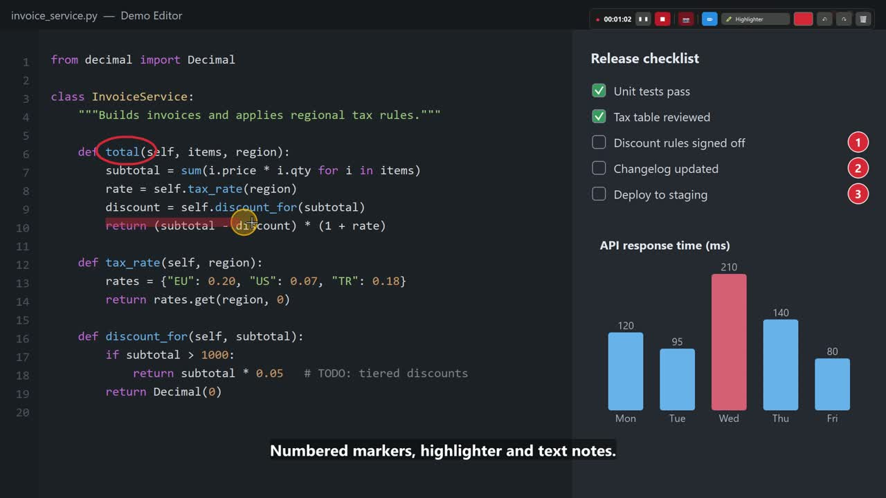
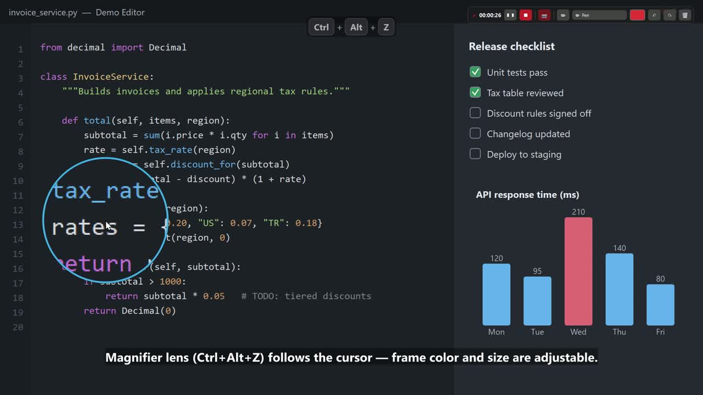
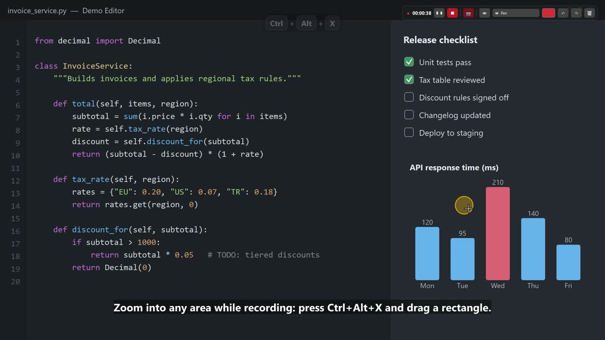
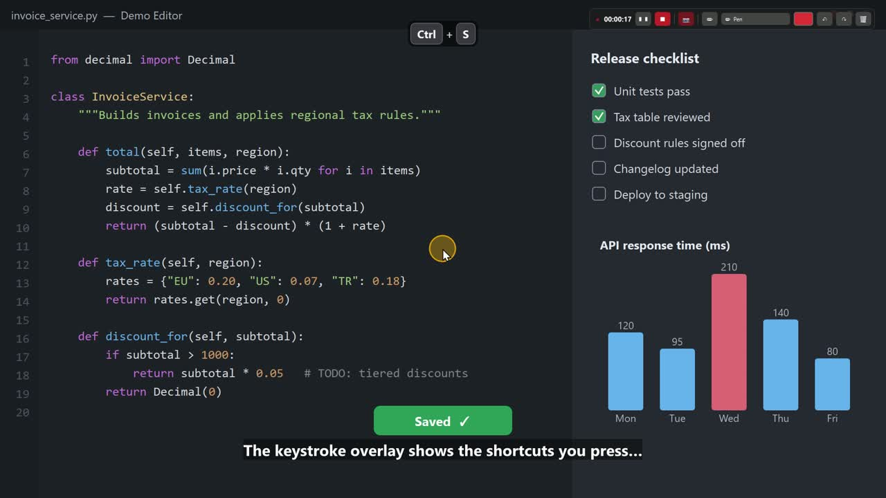

<div align="center">


# ScreenRec Studio

**GPU-accelerated screen recorder for Windows with live drawing, zoom, magnifier, keystroke overlay and webcam.**

[Download](https://github.com/ChampionXperience/screenrec-studio/releases/latest) ·
[Report a bug](https://github.com/ChampionXperience/screenrec-studio/issues/new/choose) ·
[Türkçe](#türkçe)

</div>



▶ **[Watch the 2-minute feature tour (MP4, English subtitles)](https://github.com/ChampionXperience/screenrec-studio/releases/download/v1.0.0/ScreenRecStudio-Feature-Tour-EN.mp4)** – recorded with ScreenRec Studio itself.

## Why we built it

We have been producing [technical blog](https://blog.championxperience.com) content for many years, and along the way
we used a lot of screen recorders. A feature we loved in one was always missing in another, so we kept settling for
whatever tools we had. In the end we took the features we liked most from many screen recorders, improved them and
built them into our own software. We are releasing it **completely free** so it can help content creators like us.

Have an idea or a feature request? [Open an issue](https://github.com/ChampionXperience/screenrec-studio/issues/new/choose)
or send a [pull request](https://github.com/ChampionXperience/screenrec-studio/pulls) – let's improve it together.

## Features

- **Hardware encoding** – NVIDIA NVENC (H.264 / HEVC / AV1), Intel Quick Sync, AMD AMF *(experimental)*, CPU x264 fallback.
  Video is encoded live on the GPU, so the file is ready ~2 seconds after you press Stop.
- **Any display or area** – pick a monitor or drag a region on screen.
- **Live drawing** – pen, highlighter, arrow, line, rectangle, ellipse, numbered markers, text, laser pointer, eraser;
  per-tool auto-fade, undo / redo (even after *clear all*).
- **Zoom into an area** while recording and back out with one hotkey.
- **Magnifier lens** that follows the cursor (toggle or hold-to-show), adjustable size and frame color.
- **Keystroke overlay** – shows shortcuts, including modifier + mouse combos (Alt + Click, Ctrl + Wheel).
- **Cursor highlight** with click ripples.
- **Webcam bubble** (circle or 16:9) with an iris open/close animation; drag it anywhere inside the capture area.
- **System audio + microphone**, kept in sync with the video; mute the mic from the mini bar.
- **Pause / resume** – the cursor jumps back to exactly where you paused.
- **Private mini control bar** – timer, pause, stop, mic, camera and drawing tools; never appears in the video.
- **Global hotkeys** for everything, only reserved while you record.
- **English / Turkish UI**, built-in update check and *Report a problem* button.

| Magnifier | Zoom | Keystrokes |
|---|---|---|
|  |  |  |

## Install

1. Download **`ScreenRecStudio-<version>-Setup.exe`** from the [latest release](https://github.com/ChampionXperience/screenrec-studio/releases/latest).
2. Run it. No administrator rights are needed; FFmpeg is included.

> The installer is not code-signed yet, so Windows SmartScreen may show *“Windows protected your PC”*.
> Click **More info → Run anyway**. You can verify the file with the SHA-256 shown on the release page.

The app checks GitHub for new versions at startup (can be turned off) and updates itself with one click.
Your settings live in `%APPDATA%\ScreenRec Studio` and are kept across updates.

## Requirements

- Windows 10 (2004) or Windows 11, 64-bit
- For NVIDIA NVENC: GeForce GTX 900 series or newer and **driver 570 or newer**
- Intel Quick Sync: 6th-gen Core or newer · AMD AMF: Radeon RX 400 or newer *(experimental)*

## GPU support

| GPU | Status |
|---|---|
| NVIDIA (NVENC) | ✅ Supported and tested |
| Intel (Quick Sync) | ✅ Supported and tested |
| AMD (AMF) | 🧪 Experimental – please send a [hardware report](https://github.com/ChampionXperience/screenrec-studio/issues/new?template=hardware_report.yml) |
| No GPU encoder | ✅ Falls back to CPU (x264) |

Laptops with two GPUs (e.g. Intel + NVIDIA) work: the display GPU captures, NVENC encodes.

## Default hotkeys

| Action | Hotkey |
|---|---|
| Start / resume | `Ctrl+Alt+F9` |
| Pause / resume | `Ctrl+Alt+F10` |
| Stop and save | `Ctrl+Alt+F11` |
| Magnifier | `Ctrl+Alt+Z` |
| Zoom into area | `Ctrl+Alt+X` |
| Drawing mode | `Ctrl+Alt+D` |
| Clear drawings | `Ctrl+Alt+C` |
| Undo drawing | `Ctrl+Alt+Backspace` |

All hotkeys can be changed or cleared in the settings. Only *Start* is reserved while you are not recording.

> **Tip – preview buttons:** the *Preview* buttons in the settings (highlight, magnifier, keystrokes, webcam) stay on
> until you turn them off. To exit a preview, **click the same button again** – it turns red and reads
> *“Stop preview (click again)”* while the preview is running.

## Build from source

```powershell
git clone https://github.com/ChampionXperience/screenrec-studio.git
cd screenrec-studio
py -3.12 -m pip install -r requirements.txt
# put ffmpeg.exe (8.0 essentials, from https://www.gyan.dev/ffmpeg/builds/) into .\ffmpeg\
py -3.12 src\screenrec_studio.py
```

Build the installer (needs [Inno Setup 6](https://jrsoftware.org/isinfo.php)):

```powershell
.\packaging\build.ps1
```

Releases are built automatically by GitHub Actions when a tag like `v1.2.0` is pushed.

## Privacy

ScreenRec Studio does not collect telemetry. The only network request is the update check, which asks the GitHub API
for the latest release. *Report a problem* opens a pre-filled GitHub issue in your browser; nothing is sent until you
submit it yourself.

## License

ScreenRec Studio is free software, released under the **GNU General Public License v3.0 or later** – see [LICENSE](LICENSE).
Anyone may use, study, share and modify it, but every distributed version must stay open source under the same license.
Bundled third-party components are listed in [THIRD_PARTY_NOTICES.md](THIRD_PARTY_NOTICES.md).

Created by **[ChampionXperience](https://blog.championxperience.com)**.

---

## Türkçe

**ScreenRec Studio**, Windows için ekran kartı hızlandırmalı bir ekran kaydedicidir: canlı çizim, alana zoom, mercek,
tuş gösterimi, webcam, sistem sesi ve mikrofon, duraklat/devam (imleç kaldığı yere döner).

### Neden yaptık?

Uzun yıllardır [teknik blog](https://blog.championxperience.com) içerikleri üretiyoruz. Bu sebeple birçok ekran
kaydetme programı kullandık. Birinde olan özellik diğerinde olmadığı için elimizdeki araçlarla yetinmek zorunda kaldık.
Birçok ekran kaydetme programındaki beğendiğimiz özellikleri geliştirerek kendi yazılımımıza dahil ettik. Bizim gibi
içerik üreticilere faydalı olması için **tamamen ücretsiz** yayınladık.

Bir geliştirme talebiniz varsa [öneri açın](https://github.com/ChampionXperience/screenrec-studio/issues/new/choose)
ya da [Pull Request](https://github.com/ChampionXperience/screenrec-studio/pulls) gönderin; yazılımı birlikte
geliştirelim.

**Kurulum:** [Son sürüm](https://github.com/ChampionXperience/screenrec-studio/releases/latest) sayfasından
`ScreenRecStudio-<sürüm>-Setup.exe` dosyasını indirip çalıştırın. Yönetici izni gerekmez, FFmpeg dahildir.
Kurulum dosyası henüz dijital imzalı olmadığı için Windows *“Bilgisayarınız korundu”* uyarısı gösterebilir:
**Ek bilgi → Yine de çalıştır**.

**Güncelleme:** Program açılışta GitHub'daki yeni sürümü denetler (ayarlardan kapatılabilir) ve tek tıkla günceller.
Ayarlarınız `%APPDATA%\ScreenRec Studio` klasöründe saklanır, güncellemede silinmez.

**Ekran kartları:** NVIDIA ve Intel desteklenir ve test edilmiştir; AMD deneyseldir. Donanım kodlayıcı yoksa kayıt
işlemciyle yapılır. NVIDIA için sürücü 570 veya üzeri gerekir.

**Önizleme düğmeleri:** Ayarlardaki *önizle* düğmeleri (vurgu, mercek, tuş gösterimi, webcam) siz kapatana kadar açık
kalır. Önizlemeden çıkmak için **aynı düğmeye tekrar tıklayın**; önizleme açıkken düğme kırmızı olur ve
*“Önizlemeyi durdur (tekrar tıklayın)”* yazar.

**Sorun bildirme:** Programdaki *Sorun bildir…* düğmesi, sistem bilgileri doldurulmuş bir GitHub sayfası açar.

**Lisans:** GPL-3.0 – herkes kullanabilir, değiştirebilir ve paylaşabilir; dağıtılan her sürüm aynı lisansla açık
kaynak kalmak zorundadır.
